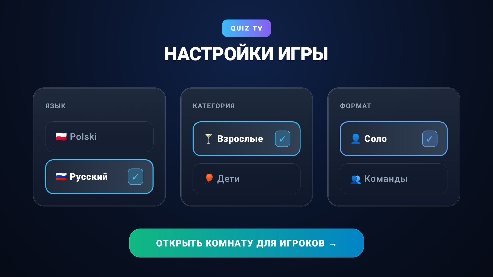
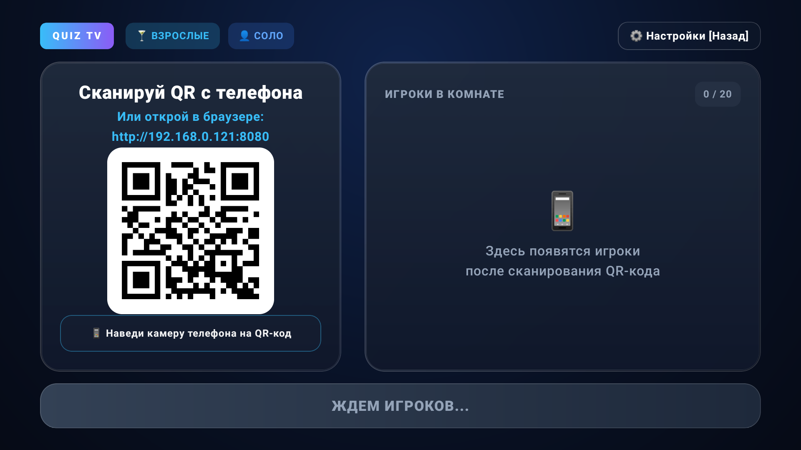
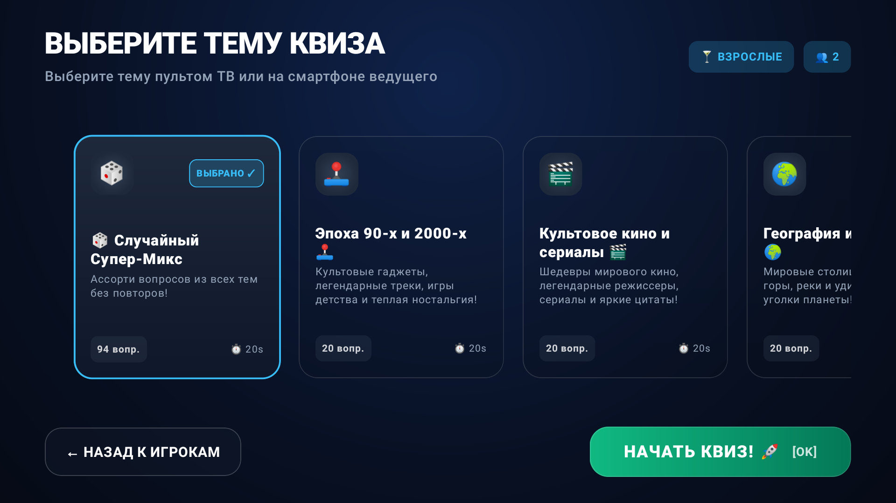
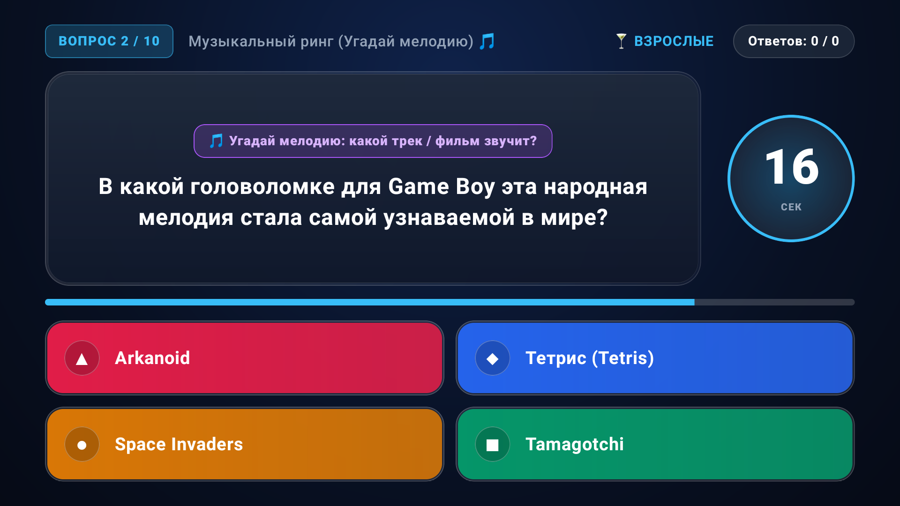
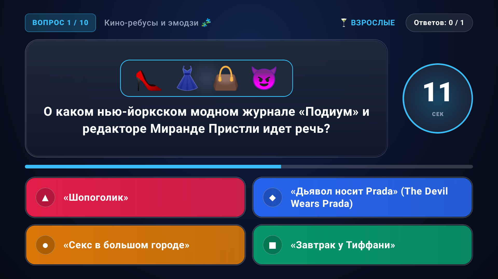

# 🎮 Quiz TV — Local Multiplayer Party Game for Android TV

**Quiz TV** is an offline, local multiplayer party quiz game in the style of *Jackbox* / *Kahoot*, engineered specifically for **Android TV** (tested and optimized for the 1GB RAM Xiaomi Mi TV Stick with Android 9 / SDK 28) and playable right from any smartphone browser without installing apps or relying on cloud servers.

---

## 📸 Screenshots

| 1. Настройки игры (Setup) | 2. Лобби и QR-код (Room Lobby) |
|---|---|
|  |  |

| 3. Выбор тем (Theme Carousel) | 4. Музыкальный ринг (Audio Quiz) |
|---|---|
|  |  |

| 5. Кино-ребусы и эмодзи (Emoji Rebus) |
|---|
|  |

---

## 🌟 Key Highlights & Features

- **📱 Zero App Install for Players**: Scan the large TV QR code or open `http://<tv-ip>:8080` in Safari/Chrome.
- **🌐 100% Offline Local Wi-Fi Execution**: Embedded Ktor CIO server directly inside the TV app. No external servers or cloud dependencies required.
- **🌍 Full Bilingual Localization**: Instant runtime switching between **Polish 🇵🇱** and **Russian 🇷🇺** with zero cross-language text bleed.
- **🎵 Real Procedural Audio Synthesizer**: TV synthesizes 14 iconic melodies directly to the TV speaker using PCM audio buffers:
  * *Star Wars (Imperial March)*, *Super Mario*, *The Pink Panther*, *Beethoven’s 5th*, *Queen*, *Tetris*, *Game of Thrones*, *James Bond 007*, *Mission: Impossible*, *Harry Potter*, *The Godfather*, *Indiana Jones*, *Titanic*, *Rick Astley*.
- **🧩 Emoji Rebus Mode**: Full-screen visual emoji puzzles to guess cult movies and pop-culture moments.
- **👥 Dynamic Teams (up to 20 Teams)**: Players can form custom teams with any name and emoji on their phones, rendered in a dynamic multi-column grid on TV.
- **👑 Floating VIP Host Controls**: Host player has a floating controller to Pause/Resume ⏸️, Force Reveal answers early ⏭️, Advance to next question ⏩, or Return to lobby 🏠.
- **🚫 Safe Family Content**: Curated question packs exclude regional/political controversy and Russian cartoon characters, focusing on global culture (Disney, Pixar, DreamWorks, Shrek, Harry Potter, European geography, etc.).
- **⚡ Super-optimized for Low-end Hardware**: Full UI designed in Jetpack Compose for Android TV with tactile Double-Bezel cards, radial timer glows, and AOT compilation support (`dex2oat -m speed`).

---

## 📦 Question Packs (`assets/packs/`)

1. **`adults_melody.json`** — *«Музыкальный ринг (Угадай мелодию) 🎵»* (Real audio playback from TV speakers).
2. **`adults_rebus.json`** — *«Кино-ребусы и эмодзи 🧩»* (Emoji-based movie riddles).
3. **`adults_90s_2000s.json`** — *«Эпоха 90-х и 2000-х 🕹️»* (Nostalgic gadgets, songs, games, Winamp, Tamagotchi).
4. **`adults_cinema.json`** — *«Культовое кино и сериалы 🎬»* (Hollywood, Tarantino, Nolan, Oscar winners).
5. **`adults_geography.json`** — *«География и страны 🌍»* (Capitals, flags, landmarks, rivers, oceans).
6. **`kids_cartoons.json`** — *«Мировые мультфильмы и герои 🎈»* (Paw Patrol, Bluey, SpongeBob, Frozen, Shrek).
7. **`kids_animals.json`** — *«Удивительные животные 🦁»* (Fascinating animal kingdom trivia).
8. **`kids_logic.json`** — *«Загадки и ребусы для детей 🧩»* (Fun logic riddles and brainteasers).

---

## 🛠️ Architecture & Tech Stack

- **Platform**: Android TV 9.0+ (API 28+)
- **UI**: Jetpack Compose TV (`androidx.tv:tv-material`, `androidx.compose.ui`)
- **Embedded Web Server**: Ktor 2.3+ (`ktor-server-cio`, `ktor-server-websockets`, `ktor-server-cors`)
- **Web Controller**: Vanilla HTML5, CSS3 Glassmorphism, Web Audio API, WebSockets (Zero external npm/CDN bundles)
- **State Machine**: Reactive Kotlin Flow (`GameStateMachine`) with lock synchronization and question history deduplication
- **Audio Synthesizer**: Procedural PCM `AudioTrack` synthesizer (`TvSoundManager`)

---

## 🚀 Build & Install via ADB

```bash
# Clone the repository
git clone https://github.com/Alex777x/quiz-tv.git
cd quiz-tv

# Connect to your Android TV / TV Stick via ADB
adb connect 192.168.0.121:5555

# Build Release APK, install, and run AOT compilation
./gradlew assembleRelease
adb install -r app/build/outputs/apk/release/app-release.apk

# Compile for maximum performance on weak CPUs
adb shell cmd package compile -m speed com.clean.quiztv

# Launch
adb shell am start -n com.clean.quiztv/.MainActivity
```

---

## 📄 License

MIT License. Free for personal, party, and educational use!
